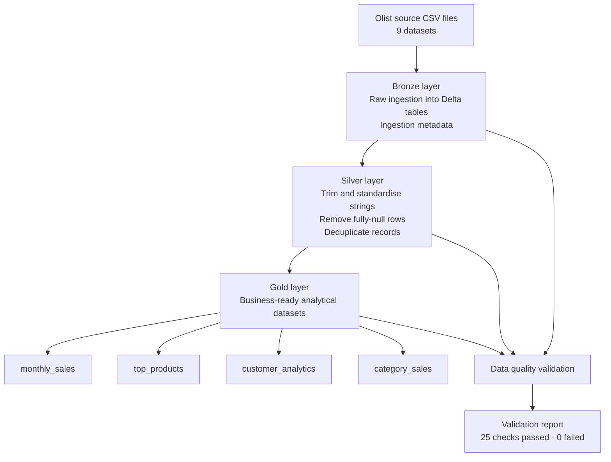

# E-Commerce Lakehouse Pipeline

<p align="center">
  <strong>End-to-end data engineering portfolio project</strong><br>
  PySpark · Delta Lake · Databricks · Medallion Architecture
</p>

<p align="center">
  
  
  
  
  
</p>

An end-to-end lakehouse pipeline that ingests Brazilian e-commerce data, preserves raw source records, transforms data through Bronze, Silver and Gold layers, and validates data quality before producing analytics-ready datasets.

## Project at a glance

| Area | Implementation |
|---|---|
| Source | Brazilian E-Commerce Public Dataset by Olist |
| Processing | Python and PySpark |
| Storage | Delta Lake |
| Cloud platform | Databricks Free Edition |
| Architecture | Medallion (Bronze → Silver → Gold) |
| Validation | Automated data quality checks |
| Version control | Git and GitHub |

## Architecture

The pipeline uses a Medallion Lakehouse design. Each layer has a distinct responsibility, making the data flow easier to understand, validate and extend.



## Business objective

E-commerce platforms generate data across customers, orders, products, payments, reviews and sellers. This project demonstrates how those separate source datasets can be ingested and transformed into consistent, analytics-ready data products.

The pipeline demonstrates:
- Reliable ingestion of multiple CSV datasets.
- Layered data processing using a Medallion architecture.
- Delta Lake storage for the processed layers.
- Data cleaning, standardisation and deduplication.
- Reusable analytical outputs for business reporting.
- Automated checks that make data issues visible.

## Source dataset

The project uses the **Brazilian E-Commerce Public Dataset by Olist**, which contains anonymised e-commerce orders and related information.

| Dataset | Description |
|---|---|
| `customers` | Customer records and location identifiers |
| `geolocation` | Brazilian postal-code geolocation data |
| `order_items` | Products, sellers, prices and freight within orders |
| `order_payments` | Payment types and payment values |
| `order_reviews` | Customer review scores and comments |
| `orders` | Order status and purchase/delivery timestamps |
| `products` | Product attributes and category identifiers |
| `sellers` | Seller records and location identifiers |
| `product_category_name_translation` | Portuguese-to-English category translations |

**Dataset source:** [Brazilian E-Commerce Public Dataset by Olist on Kaggle](https://www.kaggle.com/datasets/olistbr/brazilian-ecommerce)

**Dataset licence:** CC BY-NC-SA 4.0. The raw dataset and generated data files are intentionally excluded from this repository. Refer to the dataset provider's terms before reuse or redistribution.

## Pipeline implementation

### 1. Bronze — raw data ingestion

The Bronze layer reads the nine source CSV files and writes them as Delta tables.

- Reads source data with PySpark.
- Adds `_ingested_at` to record ingestion time.
- Adds `_source_file` to retain source-file lineage.
- Handles multiline text in `order_reviews` so review comments do not corrupt CSV column parsing.
- Persists ingested datasets in Delta format.

### 2. Silver — data transformation

The Silver layer prepares the ingested data for downstream use.

- Trims whitespace from string columns.
- Removes fully-null records.
- Removes duplicate records.
- Adds `_silver_processed_at` to record processing time.
- Writes cleaned datasets in Delta format.

### 3. Gold — business analytics

The Gold layer creates four analytical datasets.

| Gold dataset | Business purpose |
|---|---|
| `monthly_sales` | Analyses monthly sales and revenue trends |
| `top_products` | Identifies products with the highest sales |
| `customer_analytics` | Provides customer-level purchasing insights |
| `category_sales` | Analyses sales performance by product category |

**Revenue definition:** The sales measure used in this project is calculated from delivered order-item prices plus freight charges. It is a selected sales measure, not net profit. Refunds, returns and cancellation reconciliation are not included.

## Data quality validation

A dedicated validation process checks the reliability and consistency of the processed datasets.

Checks include:
- Dataset non-emptiness.
- Null values in key columns.
- Duplicate key combinations.
- Negative item-price values.
- Negative freight values.
- Invalid payment values.

### Latest validation result

| Metric | Result |
|---|---:|
| Total checks | 25 |
| Passed | 25 |
| Failed | 0 |
| Overall status | **PASSED** |

The Olist `order_reviews` source contains multiline review text. The CSV reader was configured to handle multiline records correctly; the review dataset was then reprocessed and the validation suite passed.

## Databricks notebooks

The Databricks implementation is organised into five notebooks.

| Notebook | Responsibility |
|---|---|
| `00_environment_check` | Checks the Spark environment and verifies source datasets |
| `01_bronze_ingestion` | Ingests source CSV files into Bronze Delta tables |
| `02_silver_transformation` | Cleans and transforms Bronze datasets |
| `03_gold_analytics` | Builds the four Gold analytical datasets |
| `04_data_quality` | Runs data quality checks and reports the results |

## Repository structure

```text
ecommerce-lakehouse-pipeline/
├── databricks/
│   ├── 00_environment_check.ipynb
│   ├── 01_bronze_ingestion.ipynb
│   ├── 02_silver_transformation.ipynb
│   ├── 03_gold_analytics.ipynb
│   └── 04_data_quality.ipynb
├── src/
│   ├── bronze.py
│   ├── data_quality.py
│   ├── gold.py
│   ├── ingestion.py
│   ├── silver.py
│   └── spark_test.py
├── .gitignore
└── README.md
```

The source dataset, local virtual environment and generated Delta data are excluded through `.gitignore`. This keeps the repository focused on reproducible code and notebooks rather than large data files.

## Technology stack

| Technology | Role in the project |
|---|---|
| Python 3.11 | Main programming language |
| PySpark 3.5.6 | Distributed data processing |
| Delta Lake 3.2.0 | Transactional lakehouse storage |
| Databricks Free Edition | Cloud notebook execution |
| Git and GitHub | Version control and source-code hosting |
| VS Code | Local development environment |

## Running the local pipeline

1. Download the Olist dataset from Kaggle and place the nine CSV files in `data/raw/`.
2. Create and activate a Python virtual environment.
3. Install the project dependencies used by the scripts (`pyspark`, `delta-spark`, `pandas` and `pyarrow`) in a compatible environment.
4. Run the scripts in pipeline order:

```bash
python src/spark_test.py
python src/ingestion.py
python src/bronze.py
python src/silver.py
python src/gold.py
python src/data_quality.py
```

The Databricks notebooks provide the cloud-based implementation. Review the notebook configuration and data paths before running them in another workspace.

## Key outcomes

- Ingested and processed nine related e-commerce datasets.
- Implemented Bronze, Silver and Gold layers using PySpark and Delta Lake.
- Produced four Gold analytical datasets.
- Corrected multiline CSV parsing for customer review records.
- Achieved **25 out of 25** passing data quality checks in the latest Databricks validation run.
- Published the source code and Databricks notebooks to GitHub.

## Future enhancements

The current project establishes the core lakehouse pipeline. Potential next steps include:
- Build a Power BI dashboard using the Gold datasets.
- Add a dedicated SQL analytics notebook.
- Add workflow orchestration and scheduled pipeline execution.
- Add automated tests and a CI workflow.
- Add a curated project evidence gallery with notebook and output screenshots.

## Author

**Kaushik Solanki**  
Data Analytics · Business Intelligence · Data Engineering

- [LinkedIn](https://www.linkedin.com/in/kaushiksolanki/)
- [GitHub](https://github.com/KaushikOnGitHub)
- [Portfolio](https://kaushikongithub.github.io/Kaushik-Portfolio/)

---

*This repository is a portfolio project built for learning and demonstration. Dataset ownership and licensing remain with the original provider.*
